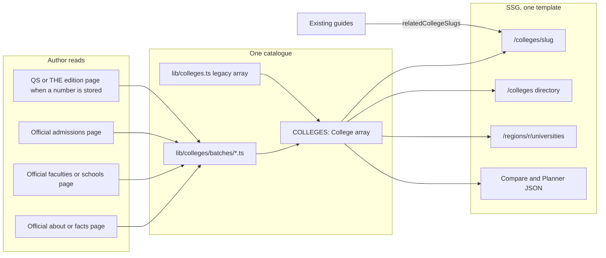

# University profiles that stay scannable as the catalogue grows

| | |
|---|---|
| Status | Proposed |
| Date | 2026-11-06 |
| Scope | Architecture only. No college records are added by this document. |
| Repo | `/Users/pratap88bhanu/Documents/gitprojects/globalstudyboard/` |
| First later batch | USA universities the guides already name, then the same record for every other region |

## Overview

GlobalStudyBoard already has one college template, one canonical URL per university (`/colleges/[slug]`), and one in-memory catalogue (`College` / `COLLEGES` in `lib/colleges.ts`). That is the right spine. What does not scale is the *shape* of a profile and the *shape* of the index.

Measured on 6 November 2026, `lib/colleges.ts` is **2,438 lines / 140,455 bytes** and holds **130** profiles:

| Region | Profiles |
|---|---|
| europe | 25 |
| uk-ireland | 21 |
| usa | 20 |
| east-southeast-asia | 16 |
| middle-east | 13 |
| russia | 11 |
| india | 10 |
| canada | 8 |
| australia-nz | 6 |

USA today is MIT through NYU, including Michigan and NYU. Berkeley (`uc-berkeley`) and UCLA (`ucla`) already exist. The guides name a further set with **no** profile (Purdue, UIUC, Washington, Texas A&M, UT Austin, UT Dallas, USC, Northeastern, Boston University, Stevens, Ohio State, Wisconsin-Madison, Minnesota, Florida, Indiana Bloomington, Penn State, Rutgers, Maryland, Arizona State, Stony Brook, Buffalo, San José State, NJIT). That candidate list is about 23 names. It is not a commitment to profile ~4,000 US degree-granting institutions, and it is not a USA-only schema.

`CollegeType` mixes three different ideas: control (`public-university`, `private-university`), form (`research-university`, `liberal-arts`, `institute-of-technology`, `business-school`, `medical-school`, `law-school`), and India brand families (`iit`, `nit`, `iim`, `aiims`, `nlu`, `iisc`). Counts today: 82 `research-university`, 16 `public-university`, 14 `institute-of-technology`, 5 `iit`, 4 `medical-school`, 3 `private-university`, 2 `iim`, and one each of `business-school`, `nit`, `aiims`, `nlu`. `liberal-arts` and `iisc` are in the union and unused. `iisc` stays reserved vocabulary (a legal `CollegeType` and, below, a `CollegeSystem`) with **zero** profiles. An IIT cannot be filtered as “an institute of technology that is also in the IIT system” because the brand slug *is* the type. Of 109 stored QS numbers, **4** have `qsYear` and **105** do not (Berkeley is `public-university`, `qs: 12`, no year). **118** of 130 profiles have no `lastVerified`. The name + country + city key has **0** collisions on the current 130.

The detail page (`app/colleges/[slug]/page.tsx`) already has the right chrome: one H1, place, `collegeImage()` hero, fact cards, attributed rankings via `collegeRankings()`, how to apply, India-only `AudienceGate` blocks, admission-test cards, a destination `<dl>`, course chips, official link, related colleges, `rankGuidesForCollege()`, Ask GSB. The lede is `descriptionEn`, one paragraph. The 114 descriptions outside East & Southeast Asia average **330** characters. The 16 East & Southeast Asia descriptions average **528**. The mean of all 130 is **355**. At least 14 contain “top ”, 9 “top-ranked”, 7 “famous”, plus “highly selective”, “prestigious”, “Public Ivies”, and “best ”. Those sentences are editorial. The constitution (`.claude/rules/content-policy.md` Rule A, §4.1, §4.5) does not allow them as facts. The new profile must not need that prose. Long how-to stays in guides. The profile is the scan layer.

The worldwide index (`app/colleges/page.tsx` + client `components/CollegesView.tsx`) renders **every** card in the server HTML and CSS-hides non-matching destinations. Each card clamps `descriptionEn` to three lines. There is no category filter and no field filter. `CollegesView` is a client component, so the card DTO — including every paragraph — is in the RSC payload and the hydration input. At 130 cards this is tolerable. At a few hundred it is a wall of hidden DOM plus a growing client payload. `/regions/[region]/universities` repeats the same clamped paragraph in `UniCard` (server-rendered, but still an essay card).

This design extends `College` in place with a **category**, an optional **system** label, and **specializations** taken only from faculties the university’s own site names. The profile becomes an ordered list of key-point sections. Empty sections are omitted. Nothing is invented to fill a gap. Existing 130 records keep rendering through `type` + `descriptionEn` + `courses` until a batch is migrated. New records can ship as soon as the template understands both shapes. The same fields apply to all nine regions.



## Background and motivation

### What already works and must not be replaced

- **One canonical unit.** `getCollegeBySlug`, `generateStaticParams()` from `COLLEGES`, self-canonical metadata through `pageMetadata()` in `lib/seo.ts`, sitemap entry per slug in `lib/sitemap-entries.ts` (`case 'colleges'`). No query-string college URLs. The site already learned this lesson with `/ask#q=` versus `?q=`.
- **Region is a peer axis, not a template axis.** `region: RegionSlug` plus optional `regions[]`, matched by `matchesRegion()` / `resolveDisplayRegions()` in `lib/regions.ts`. India is `DEFAULT_REGION`, not a separate college schema. A new page template per region is forbidden by this design.
- **Tools never import the catalogue on the client.** `lib/compare-catalogue.ts` and `lib/planner-catalogue.ts` are server-only projections served as static JSON. `scripts/check-tools.ts` fails the build if a `'use client'` module value-imports `lib/colleges.ts` (the `FORBIDDEN` regex). Any filter island must receive a plain DTO from a server page.
- **Home already projects a tiny card.** `app/page.tsx` builds `HOME_UNIVERSITIES_BY_REGION`: four colleges per destination, fields `slug`, `nameEn`, `city`, `state`, `established` only. The comment still says “118-record” and “top-ranked”; the live heading in `lib/home-ui.ts` is “Explore universities in”, which is the honest wording. Sort is `ranking.qs ?? 9999`. Unranked new profiles simply do not enter that four. Do not invent a QS number to place them there.
- **Images already have a fallback.** `collegeImage()` in `lib/images.ts` uses an exact-institution photo only when `provenance.kind === 'photo'` and `institutionSlug` matches, otherwise a region academic AI scene. The profile passes `representative`, so the on-image label stays “not this institution”. A new college does not need a new image.
- **Guides are the long form.** `rankGuidesForCollege()` in `lib/related-guides.ts` features a dedicated guide when every identity token of the slug appears in the guide slug, or `relatedCollegeSlugs` includes the college. The profile link stays. College batches do not author new guides.
- **The guides index already rejected essay cards.** `/regions/[region]/guides` is a directory of titles (“A directory rather than hundreds of repeated cards”, `app/regions/[region]/[category]/page.tsx`). University listings should follow that precedent, not the current `UniCard` paragraph.
- **Fees, when they exist at all, are programme-scoped.** `lib/programme-fees.ts` stores one reviewed yearly figure (Helsinki English Studies, 13,000 EUR, autumn 2027, non-EU/EEA) and says a range or a single programme fee must not be stored as the university’s fee. The profile must not grow a tuition section that violates that rule.
- **No tool migration for a new college.** Planner and Compare store the student’s choice. College slugs are not a SQL `CHECK` list (exam slugs are). Adding a profile does not touch `supabase/migrations`.

### What fails if we only append paragraphs

1. **Category and field are not data.** `courses: string[]` is free text (“Computer Science” vs “Computer Science & Computing” vs “Computing and Information Systems”). It cannot be a filter. `COLLEGES_BY_TYPE` exists and is not used by the listing.
2. **The index cost is linear in prose.** At the catalogue mean of 355 characters, 130 paragraphs are about **46 KB** of description text, shipped in the HTML and again in the client `items` prop. A few hundred colleges at that density are on the order of **140 KB** of description text before names, links, and the ItemList, and still twice. `hidden` does not remove nodes. Hydration still walks them.
3. **CMI requires the paragraph.** `validateContent()` in `lib/cmi.ts` errors when `descriptionEn` is missing, and the duplicate-entity key is `` `${norm(nameEn)}|${region}|${type}` ``. Two records for the same university with different `type` values would not collide. The key must become name + place, not type.
4. **Metadata repeats the editorial lede.** `generateMetadata` appends `descriptionEn` to the meta description. A “top” sentence becomes the SERP snippet.
5. **JSON-LD describes the paragraph.** `CollegeOrUniversity.description` is `metaDescription(college.descriptionEn, 300)`. A generated factual line is safer than an essay. `image` is correctly omitted (comment in the page: the hero is not a photograph of that institution).

### Constitution constraints that this design treats as already decided

From `.claude/rules/content-policy.md` and the project `Agents.md` / `Claude.md`:

- Tier-1 for a hard fact is the university’s own site, or the ranking body’s own page for that edition. No fabricated rank, fee, acceptance rate, salary, or “top” as a fact.
- QS/THE numbers only with the edition year when that page was read (`qsYear` / `theYear`, `qsTied` / `theTied`). A band (801–1000) is not a number. NIRF only for India and only as NIRF’s figure.
- `lastVerified` means the hard facts were re-read. A partial fix must not move it. Guides and exams already have `contentUpdated` for that case; colleges do not, and should gain it.
- English only. No hreflang. No new font. Fraunces + Inter, forest/cream/stone, ≥16px body, WCAG AA.
- Footer disclaimer wording is unchanged. Pages stay under the root layout.
- One canonical slug. Search-before-write. `npm run cmi:validate` must stay at 0 errors.
- Visa and work facts on the profile’s destination block stay the region record’s words plus the verify nudge already rendered. Do not copy them into the college as if the university published them.
- A university founding year is allowed. A site founding year is not.
- SSG. No server cookie reads. `overflow-x: clip` on `html`/`body` stays so the sticky header keeps working. Layout chunk stays free of `lib/colleges.ts`.

## Goals and non-goals

### Goals

1. One `College` record that a later batch can append to, for any of the nine regions, without a new route or template.
2. Separate **category** (what kind of institution) from **specializations** (fields the university’s own organisation page names) from an optional **system** label (IIT, NIT, IIM, AIIMS, NLU, IISc).
3. A profile that is key points in a fixed order. A section with no sourced fact is absent. No “TBA”, no blank fee, no essay.
4. A worldwide `/colleges` index and a per-destination `/regions/[region]/universities` index that scan as rows, filter by destination (already), category, and specialization, keep every link in server HTML, and do not hydrate the full catalogue.
5. A written checklist for adding one university: pages to read, fields allowed, slug, CMI, sitemap, related guides, image fallback, audit log.
6. The current 130 profiles render unchanged until someone migrates them. The first new USA profile does not wait on that migration.
7. Build gates that reject a rank without an edition year, a non-https source, a `specializations` array that is not `deriveSpecializations(organisation)`, a categorized `descriptionEn` that is not the identity line, a `contentUpdated` without an existing later `lastVerified`, and a categorized record whose `lastVerified` is not the latest `readOn`. Mapping a faculty name onto one of the 13 specializations is a human audit step, not something the build can prove. A homepage-only source still fails `colleges:check` (https, and not the only source).

### Non-goals

- Adding the USA batch, or any other college, in this change.
- Rewriting the ~350 USA guides, or any guide body, except a later batch’s `relatedCollegeSlugs` pointers.
- A page or filter URL for every US institution, every faculty, or every course.
- Acceptance rates, selectivity labels, “Public Ivy”, alumni, salaries, employment outcomes, or a university-wide tuition number.
- Deadlines on the profile. Dated programme requirements stay in Application Check. The profile already matches `PROGRAMMES` from `lib/application-check-catalogue.ts` (`CheckProgramme.collegeSlug` is declared in `lib/application-check.ts`; the array the page imports is the catalogue). Guides stay the long form.
- A second destination control, a client-side college database, or a CMS.
- New photography. Exact-institution photos remain the existing reviewed path in `lib/images.ts`.
- Changing the footer disclaimer, CSP, or security headers.
- Re-ranking the home spotlight. It keeps four existing profiles per destination until a later, separate decision.

## Proposed design

### 1. Taxonomy

New module `lib/college-taxonomy.ts`. It holds the closed unions, labels, and the legacy-type fallback. It must **not** import `COLLEGES` (it would cycle). `lib/college-labels.ts` may re-export labels so the profile page and Compare keep one label source. `college-labels.ts` already imports `College` as a type only, which the bundle guard allows.

```ts
/** What kind of institution this is. Five values, all nine regions. */
export type CollegeCategory =
  | 'public-research-university'
  | 'private-research-university'
  | 'institute-of-technology'
  | 'liberal-arts-college'
  | 'specialist-school';

/**
 * A named statutory or constitutional family, not a ranking club.
 * Ivy League, Russell Group, Go8, and "Public Ivy" are not systems:
 * they are editorial or membership claims and stay out of this field.
 */
export type CollegeSystem =
  | 'iit'
  | 'nit'
  | 'iim'
  | 'aiims'
  | 'nlu'
  | 'iisc';

/**
 * Fields a university is organised around. Not a course catalogue.
 * A value is stored only when `organisation` names a faculty, school,
 * college, or equivalent unit on the official site that maps to it.
 */
export type Specialization =
  | 'engineering'
  | 'computing'
  | 'natural-sciences'
  | 'mathematics'
  | 'medicine-health'
  | 'business'
  | 'law'
  | 'social-sciences'
  | 'arts-humanities'
  | 'architecture-design'
  | 'education'
  | 'agriculture-environment'
  | 'media-communication';
```

Thirteen specializations is enough to filter a few hundred profiles and small enough to explain. “AI” is not its own value: a College of Computing maps to `computing`; MBZUAI is `specialist-school` + `computing` because that is the institute, not because the site says “AI” in a sentence. Medicine, dentistry, nursing, and pharmacy map to `medicine-health` unless the author is looking at a specialist school, in which case the category is `specialist-school` and the specialization is still `medicine-health`. A law school is `specialist-school` + `law`, not a sixth category.

**Control is inside the research-university categories on purpose.** The owner’s list is “public research university, private research university, institute of technology, liberal arts college, specialist school”. Public vs private for an institute or a specialist school is a separate optional fact, because Georgia Tech and MIT are the same category:

```ts
/** Set only when the official about page states it. Never inferred from the country. */
export type CollegeControl = 'public' | 'private';
```

Show `control` as a key point only when `category` is `institute-of-technology`, `liberal-arts-college`, or `specialist-school`. Do not also show it for the two research categories; it would duplicate the category label. Do not guess. A national university in a country where “national” does not mean “public” in the US sense stays without `control` until the about page uses a word we can map (`public`, `private`, `national` where that page equates it with public funding). If the mapping is ambiguous, omit `control`.

**System is optional, small, and India-only (owner decision, 2026-11-06).** The closed set is `iit`, `nit`, `iim`, `aiims`, `nlu`, `iisc`. IIT Bombay is `category: 'institute-of-technology'`, `system: 'iit'`, `control: 'public'` once an official page is cited. The legacy `type: 'iit'` remains until that record is migrated, and the eyebrow keeps saying “Indian Institute of Technology (IIT)” via `TYPE_LABELS`. New IIT records set `system` and may still set legacy `type: 'iit'` so nothing that switches on `type` breaks. Do not add UC, CSU, SUNY, CUNY, or the University of Texas System. Berkeley and UCLA get no system chip. They stay `type: 'public-university'` until a full re-read sets `category: 'public-research-university'` with `system` unset. Do not pre-seed membership clubs.

### 2. Record

Extend `College` in `lib/colleges.ts`. New fields are optional so the current 130 object literals still typecheck.

```ts
export interface CollegeOrganisationUnit {
  /** Official name, as the university’s site prints it. Not a translation we invented. */
  name: string;
  specialization: Specialization;
  /** Specific faculty/school page, or the organisation page that lists this unit. https. */
  sourceUrl: string;
}

export interface CollegeSource {
  url: string;
  /** What this page is: "About", "Faculties", "Undergraduate admission". */
  label: string;
  /** ISO date that page was read. */
  readOn: string; // YYYY-MM-DD
}

export interface College {
  // ...existing id, slug, nameEn, type, region, regions, country, city, state,
  // established, ranking, admissionExams, applicationPlatform, programLevels,
  // englishTaught, websiteUrl, descriptionEn, courses, lastVerified

  category?: CollegeCategory;
  system?: CollegeSystem;
  /** Only for institute / liberal-arts / specialist. See taxonomy notes. */
  control?: CollegeControl;
  /**
   * Official academic units. The only input to specializations.
   * Omit the whole array rather than store an empty one.
   */
  organisation?: CollegeOrganisationUnit[];
  /**
   * Derived at the module boundary by deriveSpecializations().
   * Authors do not hand-maintain a second list.
   * Absent on legacy records. Never computed from `courses`.
   */
  specializations?: Specialization[];
  /**
   * One sourced clause when instruction is not "all English" or "not English".
   * Example: "Most programmes are taught in Korean. Some degree programmes are taught in English."
   * Omit rather than reuse descriptionEn.
   */
  instructionNote?: { text: string; sourceUrl: string };
  /**
   * Undergraduate and postgraduate routes, each one short line, only when
   * the admissions page states them. No dates here.
   */
  applyLines?: { audience: 'undergraduate' | 'postgraduate' | 'all'; text: string; sourceUrl: string }[];
  sources?: CollegeSource[];
  /** Same meaning as Guide.contentUpdated / EntranceExam.contentUpdated. */
  contentUpdated?: string;
}
```

`descriptionEn` stays **required in the type for now** so the 130 literals and `validateContent()` do not have to change in the same hour as the new fields. The template stops treating it as the page once `category` is set (see rendering). A new profile sets `descriptionEn` to the **same generated identity line the page shows**, so CMI keeps a string, and the author does not write a second paragraph. A build check rejects a categorized record whose `descriptionEn` is not that line. Metadata and JSON-LD do **not** wrap that line in the current boilerplate (“admission requirements, courses, … and how international students apply”). They pass `metaDescription(collegeIdentityLine(c), 300)` alone. Legacy records keep today’s boilerplate plus `descriptionEn`.

`courses` stays on legacy records. It is not inert. `plannerCatalogue()` copies it onto `CollegeOption`, and `PlannerApp.tsx` uses it as the “Choose or type your own” datalist (the example is “e.g. MSc Computer Science”), omitted when the array is empty. Compare labels the same array “Courses” and summarises “N course areas”. A faculty name such as “School of Engineering” would be filed as a programme and counted as a course area. **Any record with `category` set stores `courses: []`.** Do not copy `organisation[].name` into `courses`. The planner then offers free text and no datalist, which is correct: this schema does not collect a programme list. The filter does not read `courses`. Compare does not treat an empty `courses` array as “0 course areas”. The catalogue projects a ready-worded `language` string and optional specialization labels. The on-screen tool, the CSV, and the PDF all read that string. See the compatibility table.

`englishTaught` stays a boolean for old records and old fact cards. New records:

- `true` only when the about or admissions page says the medium is English (or the programmes an international applicant would enter are taught in English).
- `false` when the page says the medium is not English.
- If both exist, `englishTaught` reflects the **majority / default** medium, and `instructionNote` carries the exception. SNU’s current `englishTaught: false` stays until someone re-reads `en.snu.ac.kr`. Do not flip it in the schema PR.

`type` stays required. New records set it from a fixed map so `COLLEGES_BY_TYPE`, `TYPE_LABELS`, and any switch keep working:

| `category` | legacy `type` to store |
|---|---|
| `public-research-university` | `public-university` |
| `private-research-university` | `private-university` |
| `institute-of-technology` | `institute-of-technology`, or `iit` / `nit` / `iisc` when `system` is one of those |
| `liberal-arts-college` | `liberal-arts` |
| `specialist-school` + `system: 'iim'` | `iim` |
| `specialist-school` + `system: 'aiims'` | `aiims` |
| `specialist-school` + `system: 'nlu'` | `nlu` |
| `specialist-school` whose derived specializations include `medicine-health`, and no system above | `medical-school` |
| `specialist-school` whose derived specializations include `law`, and none of the rows above | `law-school` |
| `specialist-school` whose derived specializations include `business`, and none of the rows above | `business-school` |
| every other `specialist-school` (design school, conservatory, agriculture college, and anything else) | `research-university` |

First matching row wins, in that order. The last row is **compatibility-only**. `category` is the only label those records show (profile eyebrow, directory row, Compare `type`). `TYPE_LABELS['research-university']` (“Research university”) must not be rendered for them. Do not add a `CollegeType` member. Do not ask the author to pick a “closer” legacy value in a comment. `colleges:check` accepts only this table. `iisc` remains a legal `type` and `system` value for a future IISc profile; it has zero profiles today, and the institute row above is how a later record would set `type: 'iisc'` when `system` is `iisc`. `COLLEGES_BY_TYPE` is unused by pages and is not a reason to invent a closer type.

`deriveSpecializations(organisation)` returns the unique `Specialization` values in vocabulary order. `withDerived` lives in `lib/colleges.ts` and is applied where `COLLEGES` is exported. Do not add `lib/colleges/index.ts`. This repo resolves `@/lib/colleges` to `lib/colleges.ts`. A directory `index.ts` beside that file would either leave `withDerived` unused or make the import ambiguous for every page, CMI, the sitemap, and both tool catalogues.

```ts
export function withDerived(c: College): College {
  if (!c.organisation?.length) return c;
  return { ...c, specializations: deriveSpecializations(c.organisation) };
}

export const COLLEGES: College[] = [...LEGACY_COLLEGES, ...USA_BATCH].map(withDerived);
```

Batch files import the type only (`import type { College } from '@/lib/colleges'`). They do not value-import `COLLEGES`. Authors do not hand-copy the specialization list. The build check fails if a stored `specializations` array disagrees with `organisation`.

### 3. Identity line (replaces the essay)

`CATEGORY_LABELS` are lowercase noun phrases with no article: “public research university”, “private research university”, “institute of technology”, “liberal arts college”, “specialist school”. `TYPE_LABELS` stay title case for legacy eyebrows only. The identity line is not used for a record that has no `category`.

```ts
function identityPlace(c: College): string {
  const country = COLLEGE_COUNTRY_INFO[c.country].label;
  const cityHas = (token: string) => c.city.toLowerCase().includes(token.toLowerCase());
  // Same rule as the profile header (`place.includes(countryInfo.label)`):
  // do not emit "Singapore, Singapore" or "Hong Kong, Hong Kong".
  const parts = [c.city];
  if (c.state && !cityHas(c.state)) parts.push(c.state);
  if (!cityHas(country)) parts.push(country);
  return parts.join(', ');
}

export function collegeIdentityLine(c: College): string {
  const kind = CATEGORY_LABELS[c.category!];
  const article = /^[aeiou]/i.test(kind) ? 'an' : 'a';
  // "Massachusetts Institute of Technology is an institute of technology in Cambridge, Massachusetts, USA, established in 1861."
  return `${c.nameEn} is ${article} ${kind} in ${identityPlace(c)}, established in ${c.established}.`;
}
```

Rules for this sentence:

- It is the only unlabelled lede on a profile that has `category` set. `instructionNote` and `applyLines` are labelled key points, not a second paragraph under the H1.
- It uses the lowercase category label, not “top”, “leading”, “famous”, or “selective”.
- “Established in {year}” is the founding year already on the record. If a later source says the year is a charter date versus a predecessor college, the year changes only when the about page is re-read, and `lastVerified` moves only on a full re-check.
- Legacy profiles with no `category` keep rendering `descriptionEn` as the lede, unchanged.
- For a categorized record, `generateMetadata` description and `CollegeOrUniversity.description` are both `metaDescription(collegeIdentityLine(c), 300)`. Do not prefix the current sentence (“admission requirements, courses, the entrance tests it accepts and how international students apply”) and do not append `descriptionEn` a second time. `collegeTitle()` must not say “Courses” unless course chips are on the page. They are not, once `category` is set (`courses` is `[]` and section 15 is omitted). A categorized title uses rankings and admission tests, and “How to Apply” only when there is no dedicated guide, matching today’s guide/ranking split but with the Courses clause removed. Example: “Massachusetts Institute of Technology (USA): Rankings & Admission Tests” when a ranking and a dedicated guide both exist.

A banned-token check runs on `descriptionEn`, `instructionNote.text`, and `applyLines[].text` for any record with `category` set: `\btop\b`, `best`, `famous`, `prestigious`, `selective`, `ivy`, `guarantee`, `ranked among`. Word boundaries so “topic” is safe. This is the same class of guard as `scripts/check-tools.ts` rejecting a cost hint that states a figure.

### 4. Profile information architecture

One template: `app/colleges/[slug]/page.tsx`. No region branch except the India audience block that already exists (`college.region === 'india'`). Order below is the reading order. “Required” means the section renders for every profile. “When sourced” means the section is omitted, not filled with a placeholder, when the field is absent.

| # | Section | Required? | Source on the record | Notes |
|---|---|---|---|---|
| 1 | Header: H1 name, place line, destination link, category or legacy type eyebrow, system chip | Required | `nameEn`, `city`, `state`, `country`, `category` or `type`, `system` | Existing header. Eyebrow prefers `CATEGORY_LABELS[category]`, else `TYPE_LABELS[type]`. System chip is the existing IIT/NIT/… label, only when `system` is set. |
| 2 | Hero | Required | `collegeImage()` | Unchanged. `representative`. No new asset. |
| 3 | Identity line | Required | `collegeIdentityLine()` if `category` set, else `descriptionEn` | One sentence. Not a second paragraph under it. |
| 4 | Actions row | Required | existing buttons | Last updated, Save, Add to planner, Add to compare, Application Check link only when `PROGRAMMES` already names this `collegeSlug`. |
| 5 | Full admissions guide | When a dedicated guide exists | `rankGuidesForCollege()` | Existing card. Checklist verifies the match is this university. |
| 6 | At a glance | Required | structured fields | `<dl>`, not cards of prose. Rows: Category, Place, Established, Degree levels, Instruction. Each value is `text-base` (16px). Drop a row only if the value is missing; `established` and place are always present today. Place uses `identityPlace()` so the country is not repeated when it is already the city. Instruction uses `instructionNote.text` when set, otherwise “English-taught” / “Not mainly English-taught” from the boolean. Do not say “Local language” on a categorized profile. That phrase stays only on uncategorized profiles and in Compare when `instructionNote` is absent. |
| 7 | How it is organised | When `organisation` is non-empty | `organisation` | A list of official unit names. Each name may link to `sourceUrl`. No sentence about strengths. This list is what specializations mean. |
| 8 | Fields | When `specializations` is non-empty | derived | Text chips using `SPECIALIZATION_LABELS`. Not links to fake field URLs. No chip that is not in the vocabulary. |
| 9 | Rankings | When `collegeRankings()` is non-empty | `ranking` | Existing block, including `RANKING_NUDGE`. New records: a `qs` or `the` number without `qsYear` / `theYear` fails the build. Existing records that already store a number without a year keep rendering; do not delete them in the schema PR and do not present the missing year as if it were read. |
| 10 | How to apply | When `applyLines` or `applicationPlatform` is set | those fields | Prefer `applyLines` as a `<dl>` (Undergraduate / Postgraduate). If only the legacy string exists, show that string as today. No dates, no fees, no “you should”. |
| 11 | Audience route | India and only when we already show it | existing `AudienceGate` copy until a sourced rewrite | Keep the domestic/international split. Do not add an equivalent essay for the other eight regions. A later content pass may turn the India copy into key points; that is not required to ship the first USA profile. |
| 12 | Admission tests | When `admissionExams.length > 0` | existing resolver `findExam()` | Unchanged cards plus the verify line that links `websiteUrl`. |
| 13 | Applying in this destination | When the region exists | `lib/regions.ts` | Existing `<dl>`. The heading stays explicit that these are destination facts, not this university’s facts. Do not copy `averageTuitionRangeUsd` onto the college. |
| 14 | Reviewed programme fee | When `PROGRAMME_FEES` matches this profile | `lib/programme-fees.ts` | One row: programme name, amount, currency, year, who it applies to, source link, and the sentence that it is not the university’s fee. The Application Check button above uses `PROGRAMMES` in `lib/application-check-catalogue.ts`, not a fee. Match a fee on a new optional `collegeSlug` on `ProgrammeFee` when a fee is added; do not fuzzy-match university name in the schema PR. Until a fee row has `collegeSlug`, this section does not render (Helsinki’s existing fee has no profile slug and stays in the cost planner only). |
| 15 | Legacy fields of study | When `category` is unset and `courses.length > 0` | `courses` | Today’s chips. Omitted once `category` is set, because that record’s `courses` is `[]`. Organisation names are section 7, not chips and not planner programmes. |
| 16 | Official website | When `websiteUrl` is set | `websiteUrl` | Existing button and source caption. A **new** record fails the build without `https` `websiteUrl`. |
| 17 | Related universities, guides, Ask GSB, `RegionExplore`, `PageQuickLinks` | As today | existing | Related universities: same country, then same region, slice 4. Unchanged. |

There is no “Overview” essay, no “Why choose”, no FAQ block (the page comment already refuses `FAQPage` JSON-LD because no FAQ is visible). There is no empty heading.

**At a glance markup** (the pattern already used for destination facts on this page):

```tsx
<dl className="grid grid-cols-1 gap-x-6 gap-y-4 sm:grid-cols-2">
  <div>
    <dt className="text-xs font-semibold uppercase tracking-[0.14em] text-stone-600">Category</dt>
    <dd className="m-0 text-base text-stone-800">{categoryLabel}</dd>
  </div>
  {/* Place, Established, Degree levels, Instruction */}
</dl>
```

Eyebrow labels may stay small. Values are 16px. This is the “futuristic” requirement interpreted as calm scan structure: one column on a phone, two from `sm`, no animation, no new colour, no glass, no gradient. The existing `rounded-2xl border border-stone-200 bg-white` card is the container. Fact-card icons in the current 4-up grid can remain for legacy profiles in the schema PR; the key-point `<dl>` replaces that grid when `category` is set, so new profiles do not show the same fact twice.

Desktop, tablet, and mobile are the same sections stacked. The at-a-glance `<dl>` is the only layout change that depends on width. Touch targets on existing tool buttons stay as they are (`min-h-11` where already set).

### 5. Listing and filter

#### What is wrong with the current index, in numbers

`/colleges` server-renders a `CollegeCard` for all 130 profiles and passes that array into `CollegesView` (`'use client'`). Each card includes `descriptionEn`. Non-matching destinations are `class="hidden"` after hydration when a destination filter is on; with `unfilteredByDefault` the worldwide page shows all 130.

Rough payload if the paragraph model continues:

| Catalogue size | Description text alone (355 chars mean) | Plus card chrome and RSC duplication |
|---|---|---|
| 130 (now) | ~46 KB | Still comfortable |
| 153 (130 + ~23 USA) | ~54 KB | Fine, but still unscannable |
| 400 (a few hundred across nine regions) | ~142 KB of prose | HTML + RSC props together on the order of 250–400 KB, all nodes hydrated |
| 4,000 (out of scope) | ~1.4 MB | Not a design we will implement |

ItemList JSON-LD on `/colleges` is already one `ListItem` per college (name + URL only). At 400 colleges that is about **40–50 KB** of JSON and should stay. It does not include descriptions. Keep it through 500 profiles. Revisit only if the worldwide document’s HTML exceeds ~300 KB uncompressed.

`/regions/[region]/universities` is a server component. The largest region is Europe at 25 cards. Even at ~60 it would be acceptable as HTML. The problem is scan quality (clamped essays) and the worldwide client island, not Europe’s card count.

#### Recommended index

Keep **one** URL: `/colleges`. Do not add `/colleges?category=`, `/colleges/engineering`, or any other indexable filter URL. Do not put filters in a query string (owner decision, 2026-11-06). Category and field state live in the fragment (`#field=computing` and `#cat=` as specified below). The full list stays in the server HTML. Fragments are the project’s existing pattern (`toolHref`, `#exam=`, `#region=`): inert for search, one canonical.

Replace the card grid with a **directory grouped by destination**, in `REGION_SLUGS` order (the same destination order `app/colleges/page.tsx` already uses). **Within each destination, sort by `nameEn` using `localeCompare`.** Do not sort by `ranking.qs ?? 9999`. That comparator is what the page uses today, and 105 of 109 QS figures have no `qsYear`, so keeping it would still float undated ranks to the top of each destination after the chip is gone. The home spotlight’s QS sort is a separate non-goal and is not this directory’s sort.

```tsx
<section id="universities-usa" aria-labelledby="universities-usa-heading">
  <h2 id="universities-usa-heading">United States</h2>
  <ul>
    <li id="college-massachusetts-institute-of-technology">
      <a href="/colleges/massachusetts-institute-of-technology">Massachusetts Institute of Technology</a>
      <span>Cambridge, Massachusetts · Est. 1861</span>
      <span>Institute of technology</span>
      {/* specialization labels only when the record has them */}
    </li>
  </ul>
</section>
```

Row contents, and nothing else:

- Name, linked to `/colleges/{slug}` (the only H2/H3 text that needs to be a heading; use `h2` for the destination and a link in an `li`, not an `h2` per university — 400 `h2`s is an outline bug. The current `CollegeLink` uses `h2` per card. The directory should not.)
- Place and established year
- Category label, or legacy type label when `category` is absent
- Up to three specialization labels, then “+N” if there are more. The “+N” is a count of stored values, not a claim that other fields do not exist
- QS chip **only** when `qsYear` is set. `qsChip()` in `lib/college-labels.ts` returns `QS #n` with **no year** unless `qsYear` is set, and appends “joint” only when `qsTied` is set. The caller gates on `qsYear` first; do not describe `qsChip` as already printing a year on the 105 undated rows. Only 4 QS numbers have a year today. Legacy numbers without a year do not appear on the new row. They remain on the profile until that record is re-read. This avoids putting an undated “#1” on a scan list.

No paragraph. No three-line clamp. No admission-exam chips on the worldwide row (they wrap and they duplicate the profile). The region page may show up to three test names as now, still without the paragraph.

#### Filter mechanics

One client island, `components/CollegeDirectoryFilter.tsx`, is the **only** code that sets `hidden`. Today `CollegesView` owns that class through `useListingRegion` (`!showAll && !c.regions.includes(filterRegion)`). `RegionFilterBar` only receives counts; it does not know category or field. Two writers of `hidden` will undo each other (a category click un-hides another destination, or the destination toggle restores rows the field filter removed). Do not mount `CollegesView`, and do not call `useListingRegion` beside this island. The island renders the destination, category, and field buttons and the live count itself. It may read the remembered destination the same way the listing hook does. It applies one predicate.

```ts
interface CollegeFilterRow {
  slug: string;
  region: RegionSlug;
  regions: RegionSlug[]; // resolved on the server with resolveDisplayRegions
  /** null matches only "All". Never a sixth "unclassified" category. */
  category: CollegeCategory | null;
  specializations: Specialization[]; // empty on legacy records
}

function categoryForFilter(c: Pick<College, 'category' | 'type'>): CollegeCategory | null {
  if (c.category) return c.category;
  switch (c.type) {
    case 'institute-of-technology':
    case 'iit':
    case 'nit':
    case 'iisc':
      return 'institute-of-technology';
    case 'liberal-arts':
      return 'liberal-arts-college';
    case 'medical-school':
    case 'law-school':
    case 'business-school':
    case 'iim':
    case 'aiims':
    case 'nlu':
      return 'specialist-school';
    default:
      // research-university, public-university, private-university.
      // 82 + 16 + 3 = 101 of 130 rows today. They match only "All".
      return null;
  }
}

function rowVisible(row: CollegeFilterRow, f: Filters, scope: 'worldwide' | 'region'): boolean {
  const destinationOk =
    scope === 'region' || f.showAll || row.regions.includes(f.destination);
  const categoryOk = f.category === 'all' || row.category === f.category;
  const fieldOk = f.field === 'all' || row.specializations.includes(f.field);
  return destinationOk && categoryOk && fieldOk;
}
```

There is no `legacyGroup`. One function returns `CollegeCategory | null`. IITs, NITs, and IISc match Institute of technology without a second bucket. `system` stays unset on unmigrated records. The row’s visible label is `CATEGORY_LABELS[category]` when `category` is set, otherwise `TYPE_LABELS[type]` (“Research university”, “Public university”, “Indian Institute of Technology (IIT)”). Do not print “Not yet classified” on the row. That would assert a fact about the university. The empty-state copy, when a category button matches nothing in the current destination, says the five categories are on records whose category was read and on institute, liberal-arts, and specialist types already stored. Berkeley stays `public-university` and matches only “All” until a read sets `category`.

The server page passes the directory as **children**. Each `li` has `data-slug`. Names, cities, and years stay in that HTML and are not props of the island. The DTO is only the filter tokens above. The island joins them by `data-slug`. It does not import `lib/colleges.ts`, `lib/cmi.ts`, or a catalogue module. Pass button labels in as props. Keep `lib/college-taxonomy.ts` catalogue-free. `categoryForFilter` runs on the server when the DTO is built, so the client does not need `CollegeType`.

**Serialized size, from a fixture, not a guess.** Compact JSON, no names or places:

- A legacy row (`slug` about the length of `university-of-example-name`, `category: null`, no specializations) is **121 bytes**.
- A categorized row (`massachusetts-institute-of-technology`, ten specialization tokens) is **296 bytes**.
- 400 fully filled rows are about **119 KB**. That is over the **80 KB** filter-prop budget.
- A mix that looks like the next few batches (80 filled rows and 320 legacy rows) is about **62 KB**.

80 KB is a stop, not evidence the budget is comfortable. If a content commit’s serialized DTO would exceed 80 KB, stop shipping a parallel array: put `data-region`, `data-category`, and `data-specs` on the `li` that is already in the HTML, and pass the island only its button labels. Do not also send names and places. Until that line, the DTO is what the predicate reads.

Behaviour:

- All `<li>` elements that belong on that URL are in the server HTML. On `/colleges`, `unfilteredByDefault` means the first HTML has **no** `hidden` (same as today’s server render, where the region cookie is null). The island may hide after hydration. That flash is the same SSG trade-off as the audience toggle. Do not read the fragment on the server, and do not server-render a filtered subset.
- On `/regions/[region]/universities`, the server renders only `matchesRegion` colleges, as `UniCard` does now. Other destinations are not in the document. The island’s scope is `'region'`, so the predicate is category AND field only. `UniCard`’s paragraph is removed in that PR. The row sort is `nameEn` `localeCompare` here too.
- Specialization: a row matches if `specializations` includes the value. An empty list does not match a field filter. The empty state says “No profile in this view has that field recorded yet”, not “no such university exists”.
- The visible count is one `aria-live` region inside the island, covering destination, category, and field together.
- Keyboard: the filter controls are real `<button>`s, `aria-pressed`, visible focus, no `aria-haspopup`.
- Fragment: on mount, if `location.hash` contains `field=` or `cat=` equal to a known token, set that filter. Writing the fragment uses `history.replaceState`. Invalid tokens are ignored. Destination filter state is not written to the fragment (the remembered destination cookie already exists; do not add a second one).

Home spotlight is unchanged: four lite cards, no filter, no descriptions.

#### When the directory itself gets too big

Threshold, not a hope: if `COLLEGES.length` exceeds **800**, or the built `/colleges` HTML exceeds **300 KB** uncompressed, stop putting every row on `/colleges`. That page becomes nine destination sections with a count and a link to `/regions/{slug}/universities`, and the full row list lives only on the region page. ItemList on `/colleges` can then list the nine category URLs instead of every college; each region page keeps its own ItemList. One canonical per college is unaffected. A few hundred rows does not cross this line. Do not build the 800-row collapse now.

#### Crawl and SEO

- Every college remains at `/colleges/{slug}` with `generateStaticParams`, `pageMetadata`, and a sitemap URL.
- Internal links: directory row, region row, home card, related block, guides that set `relatedCollegeSlugs`, Compare/Planner catalogue links. No orphan new profile.
- Set `export const dynamicParams = false` on `app/colleges/[slug]/page.tsx` so an unknown slug 404s from the static shell instead of being rendered on demand. The page already calls `notFound()`. This keeps college pages static, which they already are when the slug was generated.
- Do not add hreflang.
- Bump `SITE_LASTMOD` in `lib/site-meta.ts` in the same commit that changes `/colleges` or any college page’s markup (existing sitemap rule). A college’s own sitemap lastmod and `modifiedTime` use `collegeModified()` (the later of `lastVerified` and `contentUpdated`), not `lastVerified` alone. See §7. `lib/sitemap-entries.ts` `case 'colleges'` changes in PR 1.
- Titles stay on `collegeTitle()` in the detail page, with the categorized exception in §3 (no “Courses” when chips are hidden). Do not put “top” in a new title. The index title already says “Universities Worldwide: Profiles, Rankings & How to Apply”. “Rankings” on that index title is broader than any one page; leave the `<title>` until a metadata pass. In PR 2, fix the ItemList `description`, which today is “University profiles across the USA, UK, Europe, Canada, Australia, the Middle East and India.” It drops East & Southeast Asia, Russia & CIS, and Ireland. Use the same nine destinations the page’s metadata description already names. Do not add per-college descriptions to ItemList. Leave each college URL and `numberOfItems` as they are. In that same edit, remove “best universities worldwide” and “top universities USA UK Europe” from this page’s `keywords`. Do not replace them with a new superlative.
- `collect()` in `scripts/linkcheck.ts` already walks college `websiteUrl`, `sources[].url`, and ranking URLs from `collegeRankings()`. It does not see `organisation[].sourceUrl`, `instructionNote.sourceUrl`, or `applyLines[].sourceUrl`. PR 1 extends the collector with those three. `sources[]` stays the about page plus the admissions page. Do not copy every faculty URL into `sources[]` just to be crawled. `colleges:check` still rejects a non-https URL; `links:check` is what catches a soft-404. A 403 from a university WAF stays “unreachable from here”, not dead, under the checker’s existing rule.

### 6. How a new college is added

No new college ships in the schema or directory PRs. When a content batch does ship, this is the checklist. One university per reviewable slice is acceptable; a slice of about **8–12** is the maximum that still gets a real source read. The ~23 USA names are a candidate pool, not one commit.

1. **Search first.** `getCollegeBySlug` and a normalized name check against `COLLEGES` (the new CMI key: normalized `nameEn` + `country` + `city`). Also search guide titles for “how to get into {name}” so the profile links the guide instead of duplicating it. `npm run find-home` searches **guides only** (`scripts/find-home.ts`); run it so the batch does not also spawn a new guide. A profile is not a guide. If a guide already covers admissions, the profile does not restate the steps.
2. **Slug.** Stable, lowercase, hyphenated, no year, no “best”. Prefer the official name: `university-of-illinois-urbana-champaign`, not `uiuc`. Never rename an existing slug. UIUC is not Berkeley and not “University of Illinois Chicago”.
3. **Read these official pages, and no others, for hard facts.**
   - About / facts: legal name, city, founding year, public or private if stated, category words (“research university”, “institute of technology”, “liberal arts college”).
   - Faculties, schools, or colleges list: the `organisation` array. The author chooses which closed specialization a unit maps to. The build only checks that the stored list equals `deriveSpecializations`. The audit log records the mapping. If the site does not publish that list, ship the profile **without** specializations. Do not mine the course search UI for a “top majors” list. Set `courses: []`.
   - Undergraduate admissions and, separately, postgraduate admissions: the `applyLines` and the test names already used on sibling profiles (`admissionExams` strings that `findExam()` can resolve). If a test is not in `ENTRANCE_EXAMS`, store the official name as today (the page already renders an unresolved name as a chip) and do not invent a new exam record in the college batch.
   - Ranking body page for the edition, **only if** a number will be stored. Record `qsYear` / `theYear` and `qsTied` / `theTied`. If the page was not opened, omit `ranking`.
4. **Do not record:** tuition (unless it meets the `ProgrammeFee` bar: one programme, one year, one amount, who it applies to, yearly, specific URL — and even then it goes in `lib/programme-fees.ts` with `collegeSlug`, not on the college as “the fee”), acceptance rate, deadline, salary, “selective”, alumni, religious life, political description.
5. **Sources.** `sources[]` has at least two https URLs that are not the site root: the about page and the admissions page. The cost-planner rule in `scripts/check-tools.ts` (specific page, not a homepage) is the model. `websiteUrl` may be the official apex or the English about page; it must be https.
6. **`lastVerified`.** The date of that full read. It must equal the latest `readOn` on `sources`, `organisation`, `instructionNote`, and `applyLines`. Omit `contentUpdated` on the write that first sets `category`. A static checker cannot tell that write from a later edit, so this omission is a checklist rule, not a `colleges:check` rule. A profile that has never had `lastVerified` cannot gain `category` in a partial edit. See §7.
7. **Guides.** Add this slug to `relatedCollegeSlugs` on guides that are actually about this university. Do not add it to a regional “study in the USA” overview just to create a link. After the edit, open `rankGuidesForCollege`’s dedicated match and confirm it is not a token collision (`washington` matching the wrong campus, `texas` matching both Austin and A&M, `illinois` matching Chicago). If the dedicated flag would be wrong, do not rely on token overlap; set `relatedCollegeSlugs` on the correct guide and accept that a fuzzy dedicated match may need a stopword later. File that as a follow-up rather than blocking the profile.
8. **Image.** Call `collegeImage({ slug, region })` and ship nothing. Do not add a file under `public/images` whose filename contains the university’s distinctive name (`scripts/check-images.ts` Rule A guard). An exact photo is a separate, already-specified review (licence, crop, no people) and is out of scope for a profile batch.
9. **CMI, sitemap, tools.** They pick up `COLLEGES` automatically. `npm run colleges:check` runs inside `prebuild`, so a production build already fails on a bad record. Also run `npm run cmi:validate`, `npm run links:check` (website, `sources`, organisation, instruction, and apply URLs), `npm run dup:check:strict` if any guide text changed, `npm run typecheck`, and `npm run lint`. `cmi:validate` is not on the `prebuild` hook today; the content checklist still runs it. Do not pretend the build script runs it until a later change adds it.
10. **Audit log.** A row in `.claude/rules/content-audit-log.md` for the batch: jurisdictions (destination country + audience), Tier-1 URLs opened, confirmation that no fee or rank was invented, and that an independent pass re-opened the pages. Author and auditor are not the same pass (constitution §7).
11. **`SITE_LASTMOD`.** Bump to the deploy date because `/colleges` and the region universities page change.

`lib/colleges.ts` stays the only public module. Do not add `lib/colleges/index.ts`. New batches live in `lib/colleges/batches/usa.ts` (and later `india.ts`, and so on), import `College` as a type only, and are spread inside `lib/colleges.ts`:

```ts
export const COLLEGES: College[] = [...LEGACY_COLLEGES, ...USA_BATCH].map(withDerived);
```

Do not move the existing 130 literals in the first content batch. A mechanical split of the legacy array is optional later and must be behaviour-identical. Do not create one file per university (see alternatives).

The annotated `College[]` is what keeps TypeScript off the `TS2590` union-complexity failure that `GUIDES` hit around a thousand unannotated object literals. Keep the annotation. Do not export the array without a type.

### 7. Backward compatibility

| Consumer | Today | After this design |
|---|---|---|
| 130 literals | `type`, `descriptionEn`, `courses` required in practice | Still valid. New fields absent. |
| Detail lede | Always `descriptionEn` | `descriptionEn` until `category` is set, then the identity line |
| Detail chips | `courses` | `courses` until `category` is set, then omitted (`courses: []`) |
| Eyebrow | `TYPE_LABELS[type]` | Category label when set, else the same type label. A specialist stored as compatibility `research-university` still shows “specialist school”, not “Research university”. |
| `/colleges` rows | Paragraph clamp, QS order inside the destination | Directory row, `nameEn` order inside the destination; legacy type label; no specialization until recorded |
| Compare on screen, CSV, and PDF | `CompareFacts.englishTaught` is formatted again in three places: `CompareApp.tsx` (“Language of instruction” and “N course areas” from `f.courses`), `compareCsv` in `lib/compare.ts`, and `lib/reports/compare-report.ts` | The catalogue projects `language: string`, already worded: `instructionNote.text` when set, otherwise “English-taught” or “Local language”. It also projects `specializations: string[]` (labels only). Those three formatters read `language` and do not read `englishTaught`, so they cannot fall back to “Local language” after a note exists. `CompareApp` renders a Fields row only when `specializations` is non-empty, and it does not render the Courses / “course areas” block when `courses` is empty (today that summary would say “0 course areas”). CSV and the report have no courses-count row; do not add one. They render a Fields row only when the label array is non-empty. Uncategorized profiles still produce the current two slogans, because the catalogue builds `language` from the boolean when there is no note. No rank, fee, or judgement is added. |
| Planner JSON | slug, name, region, place, url, courses | Unchanged shape. Categorized records pass `courses: []`, so `PlannerApp` shows no datalist until a real programme list exists. The student can still type a programme. |
| Home four | QS sort, lite fields | Unchanged, including the QS sort. PR 1 only corrects the “118-record” / “four top-ranked” comment in `app/page.tsx`. The live heading stays “Explore universities in”. |
| CMI | requires `descriptionEn`; entity key includes `type` | Still requires a string; key changes to name + country + city. Rejects `category` or `contentUpdated` when `lastVerified` is absent. |
| India audience blocks | Hard-coded for `region === 'india'` | Unchanged |
| Profile instruction line | “English-taught” / “Local language” | Categorized profile: `instructionNote.text` when set, otherwise “English-taught” / “Not mainly English-taught” from the boolean. “Local language” remains the boolean fallback only where `category` is unset, including Compare when there is no note. |
| Sitemap / visible date | `lastVerified` if later than `SITE_LASTMOD`, else `SITE_LASTMOD`. Visible line is `lastVerified ?? SITE_REVIEWED`. No second sentence. | `collegeModified()`, same shape as `examModified()`. Exam-style two lines once a record has both dates. |

Migration of old paragraphs is **not** a prerequisite. **118 of 130 colleges have no `lastVerified`.** The exam rule rejects `contentUpdated` when `lastVerified` is missing, and rejects it unless it is after `lastVerified`. A legacy profile in that majority cannot gain `category` or `contentUpdated` on a partial edit. The only legal migration is a **full re-read**: set `category`, `organisation`, `courses: []`, and `lastVerified` to the read date, and do **not** set `contentUpdated`. Do not stamp `lastVerified` to smuggle in a partial edit, and do not backdate it during a markup-only PR. The page keeps falling back to `SITE_REVIEWED` until that re-read.

`contentUpdated` is only for a **later** partial edit of a record that already has `lastVerified` (a dead source repaired, one sentence corrected, not every hard fact re-checked). CMI rejects a `contentUpdated` that is not after `lastVerified`.

```ts
export function collegeModified(c: College): string | undefined {
  if (c.contentUpdated && c.lastVerified && c.contentUpdated > c.lastVerified) {
    return c.contentUpdated;
  }
  return c.lastVerified;
}
```

Sitemap `case 'colleges'` and `generateMetadata` `modifiedTime` use `collegeModified() ?? SITE_LASTMOD` (keep the existing “later than SITE_LASTMOD” behaviour when the helper returns a date). The profile renders the same two-line disclosure as `app/exams/[slug]/page.tsx`: “Last verified” stays `lastVerified` when present, and when `contentUpdated` is later the page also prints “Content updated {date}, without a full re-check.” A record with only `lastVerified` shows one line. A record with neither keeps `SITE_REVIEWED` and does not invent a verification date. First publication sets `lastVerified` only.

### 8. UI constraints

- Fonts: Fraunces for the H1 and destination headings, Inter for body and the `<dl>`. No third font.
- Colour: existing forest, cream, stone, ink. No new token.
- Body 16px on the identity line, directory links, and `<dd>` values. Existing `text-sm` fact values are the thing this design replaces on profiles that have `category` set. Legacy profiles can keep the current fact cards so the schema PR does not restyle all 130 pages.
- Contrast: stone-600 on white for labels (the project already moved several stone-500 labels to stone-600 for AA). Do not use stone-400 for text.
- Motion: none beyond the current colour hover on links. `prefers-reduced-motion` is irrelevant if nothing animates.
- The directory filter must work at 320, 375, 768, 1024, and 1280. Filter buttons wrap. They do not join the header row (that row is already full at 1024px; `Agents.md` says to re-measure before adding anything there).
- Sticky header: do not set `overflow-x: hidden` on `body`. The directory does not use a horizontal scroll container for the whole page. A wrapping chip row is `flex-wrap`, not `overflow-x: auto`, unless a later measurement shows the chip row itself needs a scroller. If it does, the scroller is the chip row only, with a keyboard-accessible scroll, not `body`.
- No client-only facts. Filters hide rows; they do not fetch facts.

## API and interface changes

No HTTP API for college data. College pages stay static. Existing JSON routes pick up new fields only through their server projections.

| Surface | Change |
|---|---|
| `College` in `lib/colleges.ts` | Optional `category`, `system`, `control`, `organisation`, `specializations`, `instructionNote`, `applyLines`, `sources`, `contentUpdated`. `descriptionEn` remains. |
| `lib/college-taxonomy.ts` | New. Unions, lowercase `CATEGORY_LABELS`, `deriveSpecializations`, `collegeIdentityLine`, `identityPlace`, `categoryForFilter`, `legacyTypeFor` (the specialist table). |
| `lib/college-labels.ts` | `categoryLabel(college)` used by the profile and by `compareCatalogue().type`. `TYPE_LABELS` stays for legacy rows. |
| `lib/cmi.ts` | Entity key drops `type`. Keywords add category label, system, organisation names, specialization labels. Validation: `category` vocabulary, specialization derivation, `contentUpdated` only after an existing `lastVerified`, no `category` without `lastVerified`, banned tokens on new prose fields. `descriptionEn` still required. |
| `lib/sitemap-entries.ts` | `case 'colleges'` uses `collegeModified()`. |
| `components/CollegesView.tsx` | Removed from `/colleges` in PR 2. `CollegeDirectoryFilter` is the only `hidden` writer. |
| `app/colleges/page.tsx` | Destination sections, `nameEn` sort, filter DTO, ItemList description names all nine destinations, keywords lose “best” and “top”. |
| `app/regions/[region]/[category]/page.tsx` | `UniCard` becomes the same row. Only that region’s colleges are rendered. |
| `app/colleges/[slug]/page.tsx` | Section order in the table above. `dynamicParams = false`. Two-line freshness disclosure. Categorized title omits “Courses”. |
| `lib/compare-catalogue.ts` | `type` from `categoryLabel` when set. `courses` passed through (`[]` when categorized). New `language: string` (note text, otherwise the current two slogans). New `specializations: string[]` of labels. Stop putting `englishTaught` on the projected object the formatters read. |
| `app/tools/compare-universities/CompareApp.tsx` | Language cell renders `f.language`. Fields row only when `specializations.length > 0`. Courses block omitted when `courses.length === 0`. |
| `lib/compare.ts` `compareCsv` | Language row uses `x.language`. Fields row only when that profile’s label array is non-empty. No courses-count row. |
| `lib/reports/compare-report.ts` | Same as the CSV: `language`, and Fields only when non-empty. |
| `lib/planner-catalogue.ts` | No shape change. Empty `courses` means no datalist. |
| `lib/programme-fees.ts` | Optional `collegeSlug?: string` when a future fee should render on a profile. Not required to ship the college schema. |
| `scripts/check-colleges.ts` | New. Invoked from the `prebuild` script, not only as a standalone npm script. |
| `scripts/linkcheck.ts` | Collector also walks organisation, instruction, and apply URLs. |
| `package.json` | `"colleges:check": "tsx scripts/check-colleges.ts"` and that command appended to the existing `prebuild` string (`check-images`, `check-tools`, `check-application-check`). |

`check-colleges.ts` fails the build when any of the following is true. It does **not** claim to know that a faculty was mapped to the right specialization. That mapping is in the audit log.

- A record with `category` has no `lastVerified`.
- A record has `contentUpdated` and no `lastVerified`, or `contentUpdated` is not after `lastVerified`. The checker does not try to detect “first publication”. Omitting `contentUpdated` on the write that first sets `category` is the §6 checklist, enforced by review, not by this script. A later partial edit may set `contentUpdated` once `lastVerified` already exists and the new date is later.
- A record with `category` has `courses` other than `[]`.
- A record with `category` has `type` other than `legacyTypeFor` (the table in §2, including `research-university` for a specialist that is not IIM, AIIMS, NLU, medicine, law, or business).
- A record with `category` has a `descriptionEn` other than `collegeIdentityLine`.
- A record with `category` has a `qs` or `the` number and no edition year.
- `organisation[].sourceUrl`, `instructionNote.sourceUrl`, `applyLines[].sourceUrl`, `sources[].url`, or `websiteUrl` is not https.
- A record with `category` has fewer than two `sources` entries, or every source URL is only an apex. `websiteUrl` may be an apex. A faculty URL with a path lives on `organisation`, not duplicated into `sources`.
- The latest `readOn` among `sources`, `organisation`, `instructionNote`, and `applyLines` differs from `lastVerified` on a categorized record with no `contentUpdated`. For a partial edit, the latest `readOn` must be between `lastVerified` and `contentUpdated`, inclusive.
- `specializations` disagrees with `deriveSpecializations(organisation)`, or is set while `organisation` is empty.
- `system` is set and `category` is missing. Unmigrated `type: 'iit'` does not need `system`; the row label stays `TYPE_LABELS`.
- Banned tokens in `descriptionEn` (when `category` is set), `instructionNote.text`, and `applyLines[].text`.
- Duplicate normalized name + country + city.
- `control` set on a public or private research category.

Checks that mention `category` apply only when `category` is present, except the duplicate-name key and the `contentUpdated`-without-`lastVerified` rule, which apply to every record. There is no allow-list of slugs and no comment escape hatch.

## Data model changes

There is no database table of colleges. Supabase college references are student-authored slugs and names in planner/compare rows. No migration.

The catalogue file layout:

```
lib/colleges.ts              # College interface, withDerived, LEGACY array, COLLEGES export
lib/college-taxonomy.ts      # closed vocabularies and pure helpers
lib/college-labels.ts        # display labels and rankings (existing)
lib/colleges/batches/usa.ts  # empty until the first content batch; import type { College } only
```

There is no `lib/colleges/index.ts`. `@/lib/colleges` stays `lib/colleges.ts`.

`COLLEGES_BY_TYPE`, `COLLEGES_BY_COUNTRY`, `COLLEGES_BY_REGION`, `getCollegeBySlug` stay. Add `COLLEGES_BY_CATEGORY` only if a server page needs it. The client filter must not call it.

CMI duplicate key change:

```ts
const entityKey = `${norm(c.nameEn)}|${c.country}|${norm(c.city)}`;
```

`type` is removed from the key so a future edit that changes `iit` to `institute-of-technology` cannot hide a second record. Risk: two legitimate different institutions that share a normalized name and city (none known in the 130). A campus of the same university in another city is a different key and is still one institution if we also key on slug. The check should also flag normalized name + country when city differs, as a **warning**, not an error (University of California campuses are different institutions that share a prefix, not a normalized full name). “University of Texas at Austin” and “University of Texas at Dallas” differ. Good.

Do not key on website host alone. Shared systems sometimes share a parent domain; do warn on identical `websiteUrl`.

## Alternatives considered

### (a) Keep description paragraphs and only add more colleges

Add Purdue and the rest as today’s object shape: `type`, a 300-character `descriptionEn`, free-text `courses`.

**Why it is attractive.** Zero template work. `generateStaticParams`, CMI, Compare, and Planner already accept that shape. A content-only diff is easy to review one university at a time.

**Why it loses.** It does not separate category from specialization, so the index still cannot filter. It requires the editorial paragraph the constitution should not carry (the existing USA ledes are the evidence: MIT’s record says “consistently ranked among the world’s top” and “highly selective”; Georgia Tech’s says “top-ranked”). New paragraphs would either repeat that voice or be a one-line fact pretending to be a description, with no place to put faculties. The client grid still hydrates every paragraph. At a few hundred colleges the worldwide page is a long card list with `line-clamp-3`, which hides the only sentence the card has. Rejected as the target architecture. It remains the fallback rendering for records that have not been migrated, which is deliberate compatibility, not the design for new ones.

### (b) A separate JSON file per college

`content/colleges/massachusetts-institute-of-technology.json`, loaded by a build script into `COLLEGES`.

**Why it is attractive.** Diffs stay small. Two people can add universities without editing one 2,400-line file. A validator can run per file. This is a reasonable shape at several thousand records.

**Why it loses here.** The site’s content model is typed TS modules (`lib/guides.ts`, `lib/admission-guides.ts`, `lib/regions.ts`, `lib/colleges.ts`), imported by server pages at build time. A JSON directory needs a loader, a generated index, and a second validation path beside `tsc`. `images.generated.ts` exists because image metadata is produced by a pipeline; college facts are authored by hand and reviewed as text. JSON does not make “omit the fee” any safer, and it makes code review of a union harder (no editor exhaustiveness on `category`). One file per college also invites a page component per college, which this project must not grow. The `TS2590` pressure that split `GUIDES` into `GUIDES_*_P2` consts is avoided for colleges by the explicit `College[]` annotation and, when the legacy file becomes hard to edit, by **region batch modules** of a few dozen records, not 400 JSON files. Batch modules give small diffs without leaving the type system. Rejected as the store. Reconsider only if a single region module exceeds roughly 2,000 lines and `tsc` on `lib/colleges.ts` becomes a measured problem. That is far past a few hundred typed objects.

### (c) Structured key-point record (recommended)

The record in §2, the section table in §4, the directory in §5, legacy fields kept so old objects still render.

**Why it wins.** It matches the owner’s constraints with the least new machinery: same route, same SSG, same tool projections, same image fallback, new facts only where an official page was read, and a filter that does not hydrate essays. The cost is a template branch (`category` set or not) and a CMI key change. Both are smaller than a parallel content system.

**What it does not do.** It does not clean the 14+ “top” paragraphs until those records are migrated. Shipping the template must not be described as a content cleanup of MIT’s lede. The lede stays on screen for unmigrated records.

## Security and privacy

College pages are public, non-personal reference pages.

- No student names, emails, application files, or education records on the profile. Planner notes stay in the account tool, not in `College`.
- No new cookie, localStorage, or analytics event. The filter fragment is not user data.
- External links stay `https`, `target="_blank"`, `rel="noopener noreferrer"`, as the official-site button already does.
- Source URLs are author-controlled constants, not request input. Nothing on this surface fetches a university page at request time (SSG only). That avoids SSRF. `links:check` is an offline/build concern.
- The filter island receives slugs and enum tokens only. It must not receive `descriptionEn`, notes, or tool data.
- Do not add alumni, “notable graduates”, or donor names. Those are personal data and editorial.
- Application Check, Compare, and Planner remain account-only and unchanged in their privacy posture. A new profile only adds a row to the public catalogue those tools already project.
- Jurisdictions for a later USA batch: United States as destination, plus the worldwide audience (India DPDP, GDPR/UK-GDPR, PIPEDA, Australia/NZ APPs, and the other destination audiences). The profile states official facts and links out. It does not give immigration, financial, or admissions advice. The destination visa `<dl>` already carries the verify nudge; do not add a new visa claim on the college.

## Observability

There is no runtime service to metric. Observability is build and page weight.

- `colleges:check` is part of the `prebuild` string in `package.json`, next to `check-images`, `check-tools`, and `check-application-check`. A standalone script that `prebuild` does not call will not gate. `cmi:validate` stays a checklist command; it is not on `prebuild` today. Exit non-zero on the failures listed above.
- `npm run cmi:validate` remains 0 errors. The entity-key change should be run once on the current 130 and the result recorded in the schema PR (expected: 0 new duplicates).
- `npm run links:check` covers `websiteUrl` and any `sources[].url` that are added. Do not treat 403 from a university WAF as a dead link (existing checker rules).
- Production build page count increases by 1 per new profile (`/colleges/[slug]` already static). The schema and directory PRs should not change the page count.
- After the directory PR, record uncompressed HTML size of `/colleges` and of `/regions/usa/universities` from the build output, and the byte size of the serialized filter DTO (the fixture in §5: 121 bytes legacy, 296 bytes with ten specializations, about 119 KB if all 400 rows are filled). Budget: worldwide HTML under 300 KB uncompressed; filter DTO under 80 KB. Crossing 80 KB means drop the parallel array onto `data-*` attributes, not a claim that 400 rows still fit. Crossing 300 KB HTML or 800 rows means the collapse in §5.
- Layout chunk: confirm 0 occurrences of college descriptions in client chunks (the same grep the image work used for the registry). `CollegeDirectoryFilter` should be a few KB plus the row DTO.
- No new logging. Do not log filter state.

## Rollout plan

Four incremental commits. Content batches come after, and only when the owner asks for them. Each commit leaves the site buildable and the current 130 profiles on screen.

1. **Schema and checks, no visual change.** Types, taxonomy module, CMI key, `collegeModified`, sitemap lastmod helper, link-checker collector, `colleges:check` on `prebuild`. No record sets `category` yet, so the detail page still renders `descriptionEn` and the disclosure does not appear.
2. **Directory index.** `/colleges` and `/regions/[region]/universities` switch to rows sorted by name within the destination. One island owns `hidden`. Region pages do not render other destinations. ItemList description and keywords fixed. No new colleges. Re-measure 320–1280 and the header row. Record HTML size and filter-DTO bytes.
3. **Profile key points.** Template branch for `category`, including the exam-style freshness lines and the title/metadata rules in §3. With zero categorized records, profile HTML matches today except where commit 2 already changed the listings.
4. **First USA content batch, later, separate owner request.** 8–12 profiles, audit log, `relatedCollegeSlugs`, `SITE_LASTMOD`. Not part of implementing this document.

Rollback: commits 1–3 are template and types. Revert the directory commit to restore paragraph cards without touching college facts. Content batches revert as data. No migration to roll back.

## Risks

| Risk | Why it matters | Mitigation |
|---|---|---|
| Mapping every `public-university` to “public research university” | Asserts a category the record does not prove | Filter and labels use that category only when `category` is set. Legacy group stays “not yet classified”. |
| Deriving specializations from `courses`, or treating the build as proof the faculty mapping is right | Free-text chips would become a fake filter. The author still picks which of 13 values a faculty maps to. | `specializations` must equal `deriveSpecializations(organisation)`. The audit log records why each unit maps there. `courses` on a categorized record is `[]`, so the planner datalist and Compare’s “Courses” row do not receive faculty names. |
| Token collision in `rankGuidesForCollege` | A new “Washington” profile could feature the wrong guide | Checklist requires a human look at the dedicated match before the batch ships. |
| CMI key change flags a real pair | Could block the schema PR | Run validation before merging the key change. If a pair is two campuses, disambiguate the city field rather than weakening the key. |
| Directory hydration flash | Island hides rows after paint | Server HTML shows the full list for that page. Filters are progressive. Same trade-off as the audience toggle. |
| `descriptionEn` still required | Authors paste an essay into it | `colleges:check` rejects any `category` record whose paragraph is not the identity line. |
| Home QS sort called “top” in a code comment | A reader of `app/page.tsx` may “fix” the sort by inventing ranks | Comment correction in the schema PR. Do not change the four cards. |
| File split causes a bad spread | Dropping a legacy record during a move | Do not move legacy literals in the first batches. Diff `COLLEGES.length` in `colleges:check` against a constant updated only in a content commit, or simply assert `length >= 130`. |
| Undated QS on the new scan row, or keeping today’s within-destination sort | 105 of 109 QS numbers have no year. Sorting by `qs ?? 9999` still floats those ranks after the chip is removed. `qsChip` itself prints `QS #n` with no year unless `qsYear` is set. | Directory sort is `nameEn`. The chip is rendered only when the caller has required `qsYear`. Profile still shows legacy numbers. Home QS sort is untouched. |
| Scope creep into 4,000 US schools | Thin pages, duplicated guides | Candidate list is the names guides already use. No other US profile without a new owner decision. The 800-row note is a performance cap, not a content target. |

## Open questions

None. The two choices that were open here were decided by the owner on 2026-11-06.

1. **`CollegeSystem` stays India-only.** Values are `iit`, `nit`, `iim`, `aiims`, `nlu`, `iisc`. Do not add UC, CSU, SUNY, CUNY, or the University of Texas System. Berkeley and UCLA are not given a system chip. They stay `public-university` until a full re-read sets `category: 'public-research-university'` with no system.
2. **Directory filters use a fragment** (`#field=computing` and the category fragment). One canonical `/colleges` URL. The full list remains in the server HTML. Do not use a query string.

## References

- `lib/colleges.ts` — `College`, `CollegeType`, `CollegeCountry`, `ProgramLevel`, `COLLEGES`, `getCollegeBySlug`, `COLLEGES_BY_TYPE`
- `lib/college-labels.ts` — `TYPE_LABELS`, `LEVEL_LABELS`, `collegeRankings()`, `qsChip()`, `RANKING_NUDGE`
- `app/colleges/[slug]/page.tsx` — profile template, `collegeTitle`, `hasAnyRanking`, `findExam`, JSON-LD
- `app/colleges/page.tsx`, `components/CollegesView.tsx` — worldwide index and client hide
- `app/regions/[region]/[category]/page.tsx` — `UniCard`, guides directory precedent
- `app/page.tsx`, `components/HomeSpotlight.tsx`, `lib/home-ui.ts` — four-college projection
- `lib/cmi.ts` — `buildContentIndex`, `validateContent` college loop, breadcrumbs
- `lib/sitemap-entries.ts` — college lastmod
- `lib/compare-catalogue.ts`, `lib/planner-catalogue.ts` — server projections
- `lib/related-guides.ts` — `rankGuidesForCollege`
- `lib/images.ts` — `collegeImage`, `COLLEGE_ACADEMIC_SCENES`
- `lib/programme-fees.ts` — the only pattern for a sourced fee
- `lib/regions.ts` — `matchesRegion`, destination facts already rendered on the profile
- `scripts/check-tools.ts` — bundle guard and “specific https page, not a homepage”
- `scripts/find-home.ts` — guide merge-first; does not search colleges
- `.claude/rules/content-policy.md` — Rules A–E, §5 freshness, §11 canonical unit, §13 SEO, §15 readability, §16 region, §18 tools
- `.claude/rules/content-qa-checklist.md` — independent pass before a content batch

## PR plan

Each “PR” is one commit on `main`. Do not commit unless the owner asks. No college records in PR 1–3.

### PR 1 — College taxonomy types and build checks

- **Depends on:** nothing
- **Files:** `lib/college-taxonomy.ts` (new), `lib/colleges.ts` (optional fields and `collegeModified` only), `lib/college-labels.ts` (`categoryLabel`), `lib/cmi.ts` (entity key, keyword fields, `lastVerified` / `contentUpdated` rules), `lib/sitemap-entries.ts` (`collegeModified` for `case 'colleges'`), `scripts/check-colleges.ts` (new), `scripts/linkcheck.ts` (organisation, instruction, and apply URLs), `package.json` (`colleges:check` script **and** the `prebuild` string), `app/page.tsx` comment that still says “118-record” / “top-ranked” (comment only; do not change the QS sort)
- **Description:** Closed category, system, and specialization types, including the specialist `CollegeType` table and `categoryForFilter`. Existing literals unchanged and still valid. CMI duplicate key no longer includes `type` (0 collisions on the current 130). `colleges:check` passes because no record sets `category` yet. Sitemap output is unchanged while no college has `contentUpdated`. No profile HTML change. `iisc` is reserved and still unused.

### PR 2 — Scannable college directory

- **Depends on:** PR 1
- **Files:** `app/colleges/page.tsx`, `components/CollegesView.tsx` (stop using it on this route), `components/CollegeDirectoryFilter.tsx` (new; the only `hidden` writer), `app/regions/[region]/[category]/page.tsx` (`UniCard`), `lib/site-meta.ts` (`SITE_LASTMOD` only if this commit is the one that will ship)
- **Description:** Worldwide and per-region lists become rows: name, place, year, legacy type label or category label. Within each destination, sort by `nameEn`, not QS. `/colleges` first HTML has no `hidden`. The region page renders only that destination’s colleges; the island then applies category AND field. The DTO has no names or places (`data-slug` joins the children). `categoryForFilter` returns null for research/public/private, so those 101 rows match only “All”. IITs match Institute of technology. Specialization filter matches nothing until data exists. ItemList description names all nine destinations. Keywords drop “best” and “top”. Measure HTML size, filter-DTO bytes, and the header at 1024px. Profile pages still show today’s paragraphs.

### PR 3 — Key-point profile template

- **Depends on:** PR 1. Can follow PR 2 or land beside it, but review the profile separately from the directory.
- **Files:** `app/colleges/[slug]/page.tsx`, `lib/compare-catalogue.ts`, `app/tools/compare-universities/CompareApp.tsx`, `lib/compare.ts` (`compareCsv`), `lib/reports/compare-report.ts`, `lib/college-taxonomy.ts` if `collegeIdentityLine` was not finished in PR 1
- **Description:** When `category` is set, render the section table in §4, hide course chips, and set metadata and JSON-LD to the identity line with no “courses” sentence. `collegeTitle` omits “Courses”. Render the exam-page two-line freshness disclosure via `collegeModified`. When `category` is unset, render today’s lede, fact cards, chips, and single date line. Set `dynamicParams = false`. In the same commit, the catalogue projects `language` and `specializations` labels and stops handing `englishTaught` to the formatters. `CompareApp`, `compareCsv`, and `compare-report.ts` render `language`. Fields appears only when the label array is non-empty. `CompareApp` omits the Courses block when `courses` is empty, so a categorized profile does not read “0 course areas”. With zero categorized records, the 130 profiles still show “English-taught” or “Local language” and their existing course lists. No visual change on those profiles until a record gains `category`, which PR 1 forbids without `lastVerified`.

### PR 4 — First USA profile batch (later, owner-requested, not this document)

- **Depends on:** PR 1–3, plus an independent source read
- **Files:** `lib/colleges/batches/usa.ts` (new), `lib/colleges.ts` (spread), selected `relatedCollegeSlugs` in `lib/guides.ts`, `.claude/rules/content-audit-log.md`, `lib/site-meta.ts` (`SITE_LASTMOD`)
- **Description:** 8–12 universities from the candidate list that guides already name and that do not already have a slug. Checklist in §6. Each new record has `category`, `courses: []`, `lastVerified` equal to the latest `readOn`, and no `contentUpdated`. Faculty-to-specialization choices are in the audit log, not implied by the build. No new guides, no new exam records, no fees unless a `ProgrammeFee` row meets the existing bar. `prebuild` (including `colleges:check`), `cmi:validate`, `links:check`, lint, typecheck, production build. Further regions reuse the same batch-module pattern (`europe.ts`, and so on) with no template change. The USA batch stays deferred until the owner asks.

## Key decisions

1. **Extend `College`; do not add a route or a per-region template.** `app/colleges/[slug]/page.tsx` is already region-agnostic except the India audience block. A USA-only schema would violate the nine-peer rule the moment the same work is needed for Europe.
2. **Category, system, and specialization are three fields.** `CollegeType` conflates them. New category is the five-value list the owner named. India brands survive as `CollegeSystem`, not as the only category. Specializations are a closed 13-value vocabulary derived from official unit names, never from `courses`.
3. **Legacy `public-university`, `private-university`, and `research-university` match only “All”.** `categoryForFilter` returns null. There is no `legacyGroup` and no on-row “unclassified” label. IITs, NITs, and IISc match Institute of technology because their stored `type` already says so. Berkeley stays out of Public research university until a read sets `category`.
4. **The identity line is generated, not authored, once `category` is set.** Place omits a country or state token already contained in the city. Category labels are lowercase noun phrases. Metadata and JSON-LD are that line only, with no second “courses” sentence, and the title does not say “Courses” while chips are hidden. `descriptionEn` remains on the type so CMI and the 130 literals do not break; `colleges:check` forces it to equal the generated line for categorized records.
5. **Omit, do not placeholder.** No fee section, no deadline section, no empty ranking, no specialization chips inferred from old course strings. `ProgrammeFee` remains the only fee record, and it is programme-scoped.
6. **One canonical URL per college, and one worldwide index URL.** One island sets `hidden` with one AND predicate. `/colleges` ships every row with no `hidden` in the first HTML. A region universities page does not render the other eight destinations. Query-string indexes are rejected for the same reason `?q=` was rejected. Within a destination, rows sort by name, not by undated QS.
7. **The client receives filter tokens, not essays or place names.** A legacy filter row is 121 bytes. A row with a long slug and ten specializations is 296 bytes. Four hundred filled rows are about 119 KB, which fails the 80 KB DTO budget and must move onto `data-*` attributes already on the `li`. Full `College[]` stays on the server.
8. **Do not map specialization filters onto legacy rows.** An empty `specializations` array means “not recorded”, and the empty state says so. Guessing from “Computer Science” chips would put a wrong filter in front of every old profile.
9. **QS on the scan row requires the caller to see `qsYear` before calling `qsChip`.** `qsChip` omits the year on the 105 undated numbers. The profile may still show an existing number that has no year. New ranks without an edition fail the build. Directory order does not use QS at all.
10. **New profiles do not wait for a rewrite of the 130, and a partial edit cannot pretend to be one.** The template branches on `category`. Setting `category` requires `lastVerified` from a full re-read and forbids `contentUpdated` on that same write. `contentUpdated` is only a later partial edit of a record that already has `lastVerified`. `collegeModified()` feeds the sitemap and the visible date. The 118 unstamped profiles stay unstamped through the markup PRs.
11. **Batch TS modules, not one JSON file per college, and not a second `lib/colleges/index.ts`.** Typed `College[]` is spread and passed through `withDerived` inside `lib/colleges.ts`. Batch files import the `College` type only. JSON per college adds a loader without making facts more accurate. A directory index beside `lib/colleges.ts` would make `@/lib/colleges` ambiguous.
12. **Guides stay the long form.** A profile links `rankGuidesForCollege` and does not absorb how-to steps. `find-home` still runs so a college batch does not also create a duplicate guide.
13. **No new image and no new tool table.** `collegeImage()` already falls back. Categorized records store `courses: []`, so the planner datalist stays off and Compare does not show “0 course areas”. The catalogue’s `language` string is what `CompareApp`, `compareCsv`, and the compare report render. Fields is that label list, omitted when empty. No Supabase migration. A specialist that is not IIM, AIIMS, NLU, medicine, law, or business stores legacy `type: 'research-university'` and is labelled only from `category`.
14. **`CollegeSystem` is India-only (owner, 2026-11-06):** `iit`, `nit`, `iim`, `aiims`, `nlu`, `iisc`. No UC, CSU, SUNY, CUNY, or University of Texas System, and no system chip on Berkeley or UCLA. They stay `public-university` until a full re-read sets `public-research-university` with `system` unset. Directory filters are a fragment (`#field=` and `#cat=`), not a query string. `/colleges` stays the one canonical index, and the full list stays in the server HTML.
15. **Performance collapse is specified at 800 rows or 300 KB HTML, and the filter DTO stops at 80 KB, not built as a second architecture now.** The target catalogue is a few hundred profiles across nine regions. The directory is sized for that, not for every degree-granting institution. The build does not prove a faculty-to-specialization mapping; the audit log does.
